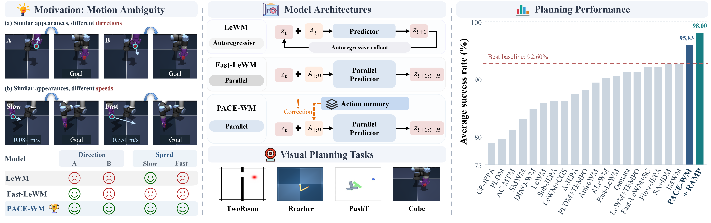
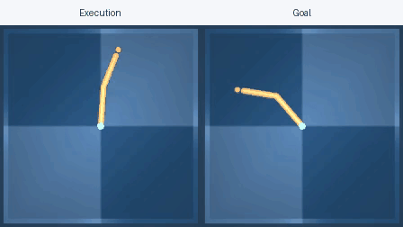

  

<h1 align="center">PACE-WM:Parallel World Modeling with Action History for Visual Planning</h1>

Executed-action memory for motion-aware visual planning.

  <a href="#overview">Overview</a> ·
  <a href="#method">Method</a> ·
  <a href="#visual-planning-demos">Demos</a> ·
  <a href="#results">Results</a> ·
  <a href="#controlled-benchmarks">Benchmarks</a> ·
  <a href="#release-status">Release Status</a>

---

## Overview

Similar visual observations can conceal different motion states. **PACE-WM** uses the history of executed actions to provide dynamic context and predicts multiple future representations in parallel. **Reference-Anchored Minimum Progress (RAMP)** adds a goal-directed planning criterion based on direct and split predictions.

Across four visual planning tasks, PACE-WM achieves **95.83%** average success, increasing to **98.00%** with RAMP.

## Method

1. **Remember executed actions.** An action-only recurrent encoder summarizes past controls into a persistent memory.
2. **Predict future representations in parallel.** The memory corrects the first future action block. A causal Transformer propagates this context across future action prefixes and predicts multiple future representations without recursive predicted-state feedback within each prediction window.
3. **Evaluate goal progress with RAMP.** Direct and split predictions measure candidate progress relative to their respective costs for a shared reference action sequence. At unit weight, RAMP maximizes the smaller predicted improvement.
4. **Execute and update.** The controller executes the selected controls, updates its persistent action memory, and replans from the new observation.

PACE-WM and PACE-WM + RAMP use the same trained model weights. RAMP changes the planning score without additional model training.

## Visual Planning Demos

PACE-WM with RAMP in action across four visual planning tasks. Each animation shows the executed trajectory on the left and the goal image on the right.

<table>
  <tr>
    <th align="center">TwoRoom</th>
    <th align="center">Reacher</th>
  </tr>
  <tr>
    <td width="50%"></td>
    <td width="50%"></td>
  </tr>
  <tr>
    <th align="center">PushT</th>
    <th align="center">Cube</th>
  </tr>
  <tr>
    <td width="50%"></td>
    <td width="50%"></td>
  </tr>
</table>

These clips illustrate individual episodes. Aggregate success rates are reported below.

## Results

Main visual planning results from Table 1 of the paper. Success rates (%) are mean ± sample standard deviation across three training seeds. Avg. is the unweighted four-task mean.

| Model | TwoRoom | Reacher | PushT | Cube | Avg. |
| :--- | ---: | ---: | ---: | ---: | ---: |
| PACE-WM | **100.00** ± 0.00 | 92.67 ± 1.15 | 96.67 ± 2.31 | 94.00 ± 2.00 | 95.83 |
| PACE-WM + RAMP | **100.00** ± 0.00 | **98.00** ± 0.00 | **98.00** ± 2.00 | **96.00** ± 0.00 | **98.00** |

RAMP raises average success by **2.17 percentage points**, with gains on Reacher, PushT, and Cube while maintaining **100.00%** on TwoRoom.

## Release Status

This repository currently provides the project overview, results, and demonstration GIFs. **Code are coming soon.** Installation, training, and evaluation instructions will accompany the code release.

For questions or documentation corrections, please [open an issue](https://github.com/LHS180/PACE-WM/issues).
