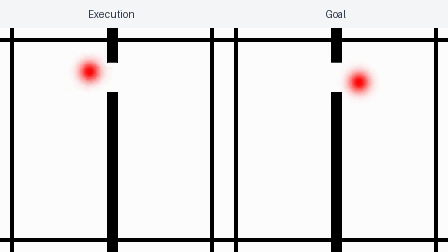
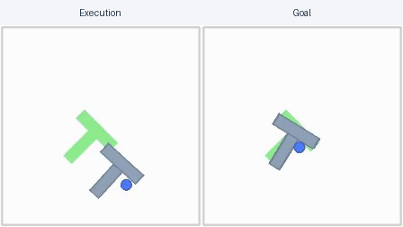
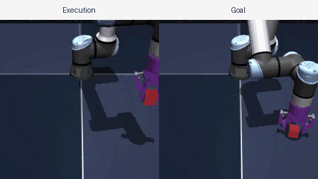

<p align="center">
  
  <a href="#release-status"></a>
</p>

<p align="center">
  
</p>

<h2 align="center">Parallel World Modeling with Action History for Visual Planning</h2>

<p align="center">
  Haishan Liu · Shijie Lian · Bin Yu · Yao Zhang · Changti Wu · Fanping Liu<br>
  Jianzheng Liu · Lei Xie<sup>†</sup> · Cong Huang<sup>†</sup> · Kai Chen<sup>†</sup><br>
  <sub>† Corresponding authors</sub>
</p>

<p align="center">Remember past actions. Predict future states in parallel. Plan toward the goal.</p>

<p align="center">
  <a href="#overview">Overview</a> ·
  <a href="#method">Method</a> ·
  <a href="#visual-planning-demos">Demos</a> ·
  <a href="#results">Results</a> ·
  <a href="#controlled-benchmarks">Benchmarks</a> ·
  <a href="#repository-contents">Contents</a> ·
  <a href="#release-status">Release Status</a>
</p>

---

## Overview

Similar visual observations can conceal different motion states. **PACE-WM** summarizes executed actions into a persistent memory and uses this context to predict multiple future representations in parallel. **Reference-Anchored Minimum Progress (RAMP)** compares goal progress under direct and split predictions to score candidate action sequences.Across four visual planning tasks, PACE-WM achieves **95.83%** average success, increasing to **98.00%** with RAMP.

<p align="center">
  <a href="assets/overview.png"></a>
</p>

## Method

1. **Remember executed actions.** An action-only recurrent encoder summarizes past controls into a persistent memory.
2. **Predict future representations in parallel.** The memory corrects the first future action block. A causal Transformer propagates this context across future action prefixes and predicts multiple future representations without recursive predicted-state feedback within each prediction window.
3. **Evaluate goal progress with RAMP.** Direct and split predictions measure candidate progress relative to their respective costs for a shared reference action sequence. At unit weight, RAMP maximizes the smaller predicted improvement.
4. **Execute and update.** The controller executes the selected controls, updates its persistent action memory, and replans from the new observation.

## Visual Planning Demos

PACE-WM with RAMP in action across four visual planning tasks. Each animation shows the executed trajectory on the left and the goal image on the right.

<table>
  <tr>
    <th align="center" width="25%">TwoRoom</th>
    <th align="center" width="25%">Reacher</th>
    <th align="center" width="25%">PushT</th>
    <th align="center" width="25%">Cube</th>
  </tr>
  <tr>
    <td width="25%"></td>
    <td width="25%"></td>
    <td width="25%"></td>
    <td width="25%"></td>
  </tr>
</table>

## Results

Visual planning success rates (%) from Table 1 of the paper. PACE-WM results report mean ± sample standard deviation across three training seeds.

| Model | TwoRoom | Reacher | PushT | Cube | Avg. |
| :--- | ---: | ---: | ---: | ---: | ---: |
| LeWM | 87.00 | 86.00 | 96.00 | 74.00 | 85.75 |
| Fast-LeWM | 98.00 | 88.00 | 96.00 | 80.00 | 90.50 |
| PACE-WM | **100.00** ± 0.00 | 92.67 ± 1.15 | 96.67 ± 2.31 | 94.00 ± 2.00 | 95.83 |
| PACE-WM + RAMP | **100.00** ± 0.00 | **98.00** ± 0.00 | **98.00** ± 2.00 | **96.00** ± 0.00 | **98.00** |

## Controlled Benchmarks

We construct four controlled benchmarks to evaluate how executed-action history helps resolve motion ambiguity, account for ongoing motion relative to the goal, and adapt to goal changes.

| Benchmark | What it examines |
| :--- | :--- |
| **Direction ambiguity** | Distinguishing motion directions under similar visual appearances. |
| **Speed ambiguity** | Handling different speeds under similar visual appearances. |
| **Goal-relative motion** | Planning when ongoing motion approaches or moves away from the goal. |
| **Goal switching** | Adapting to a changed goal while retaining the executed-action history. |

## Repository Contents

```text
PACE-WM/
├── README.md
├── .gitignore
└── assets/
    ├── logo.png
    ├── overview.png
    ├── tworoom.gif
    ├── reacher.gif
    ├── pusht.gif
    ├── cube.gif
    └── badges/
        ├── code.svg
        └── paper.svg
```

## Release Status

**Code is coming soon.** This repository currently contains the project overview, results, and demonstration GIFs.

For questions or documentation corrections, please [open an issue](https://github.com/LHS180/PACE-WM/issues).
